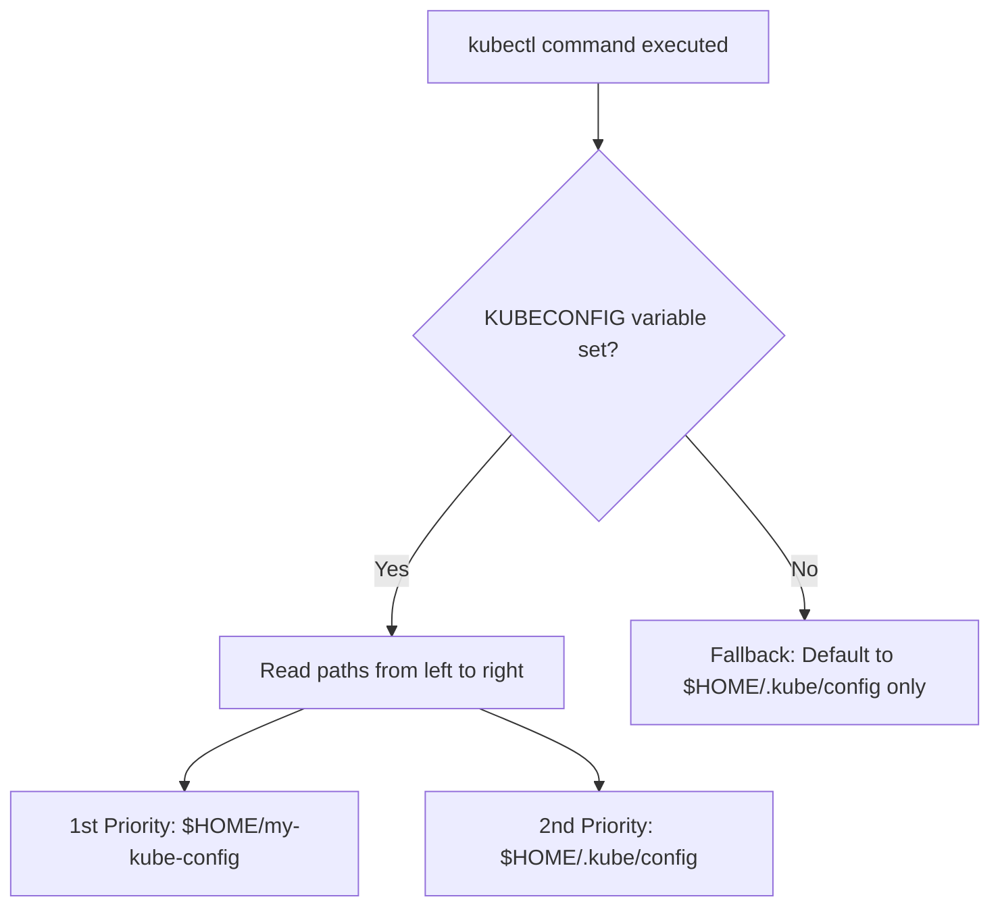

[[DevOps/Kubernetes/Security/Security|Security]]

https://notes.kodekloud.com/docs/Certified-Kubernetes-Administrator-CKA/Security/KubeConfig/page#understanding-the-kubeconfig-file
By default, kubectl searches for a kubeconfig file named “config” in the ~/.kube directory.

Without kubeconfig file kube request and command would be like below
```curl
curl https://my-kube-playground:6443/api/v1/pods \
  --key admin.key \
  --cert admin.crt \
  --cacert ca.crt
```

```bash
kubectl get pods \
  --server https://my-kube-playground:6443 \
  --client-key admin.key \
  --client-certificate admin.crt \
  --certificate-authority ca.crt
```
With kubeconfig set properly the command becomes
```bash
kubectl get pods
```
Sample config file
```yml
apiVersion: v1
kind: Config
clusters:
- name: my-kube-playground  # values hidden…
- name: development
- name: production
- name: google
contexts:
- name: my-kube-admin@my-kube-playground
- name: dev-user@google
- name: prod-user@production
users:
- name: my-kube-admin
- name: admin
- name: dev-user
- name: prod-user
```

```bash
kubectl config view
```

```yml
apiVersion: v1
kind: Config
current-context: kubernetes-admin@kubernetes
clusters:
- cluster:
    certificate-authority-data: REDACTED
    server: https://172.17.0.5:6443
  name: kubernetes
contexts:
- context:
    cluster: kubernetes
    user: kubernetes-admin
  name: kubernetes-admin@kubernetes
users:
- name: kubernetes-admin
  user:
    client-certificate-data: REDACTED
    client-key-data: REDACTED
```
Using custom config file
```bash
kubectl config view --kubeconfig=my-custom-config
```

```bash
kubectl config use-context prod-user@production
```

To specify a default namespace (for example, “finance”), simply add the `namespace` field:
### Managing Certificates in Kubeconfig Files
Use full path
```yaml
apiVersion: v1
kind: Config
clusters:
- name: production
  cluster:
    certificate-authority: /etc/kubernetes/pki/ca.crt
```
Additionally use base64 encoded data for cert value
```yml
apiVersion: v1
kind: Config
clusters:
- name: production
  cluster:
    certificate-authority: /etc/kubernetes/pki/ca.crt
    certificate-authority-data: LS0tLS1CRUdJTiBD...
```

---
# ☸️ Setting up `my-kube-config` as Default (Persistent & Non-Destructive)

## 📌 Overview
This tutorial guides you through setting a custom Kubernetes configuration file (`my-kube-config`) as your default choice. This method **will not overwrite** your existing `~/.kube/config` and ensures the configuration remains active across system reboots and new terminal sessions.

---

## 🛠️ Step-by-Step Implementation

### Step 1: Backup Existing Configuration
Before making changes to environment variables, it is best practice to back up your original configurations.
```bash
cp ~/.kube/config ~/.kube/config.bak
```

### Step 2: Configure Environment Variables
To make this persistent, append the `KUBECONFIG` environment variable to your shell's runtime configuration file. Listing your new file first ensures **precedence** over the default one.

> [!NOTE] 
> Choose the tab below that matches your active shell environment.

###### Bash
```bash
# Append the multi-config path to your bash profile
echo 'export KUBECONFIG=$HOME/my-kube-config:$HOME/.kube/config' >> ~/.bashrc

# Reload the profile to apply changes immediately
source ~/.bashrc
```

###### Zsh
```bash
# Append the multi-config path to your zsh profile
echo 'export KUBECONFIG=$HOME/my-kube-config:$HOME/.kube/config' >> ~/.zshrc

# Reload the profile to apply changes immediately
source ~/.zshrc
```

### Step 3: Verification
Verify that `kubectl` successfully merges both configuration files and prioritizes the new settings.
```bash
# View the merged configuration mapping
kubectl config view

# Verify you are pointing to the intended cluster
kubectl cluster-info
```

---

## 🧠 Mechanics & Architecture



### Key Technical Concepts
* **Precedence Order**: Paths loaded into the `KUBECONFIG` environment variable are evaluated **left-to-right**. Contexts, clusters, or users with identical names in `my-kube-config` will mask those in `~/.kube/config`.
* **Non-Destructive Merging**: When you modify configurations using commands like `kubectl config set-context`, changes are written directly to the **first file** listed in the variable pipeline (`my-kube-config`), leaving your default file safely untouched.

---
## 🔗 Related Notes
* [[Kubectl Cheat Sheet]]
* [[Managing Multiple Kubernetes Clusters]]
---
# API Groups
https://notes.kodekloud.com/docs/Certified-Kubernetes-Administrator-CKA/Security/API-Groups/page
![[Pasted image 20261010015622.png]]
